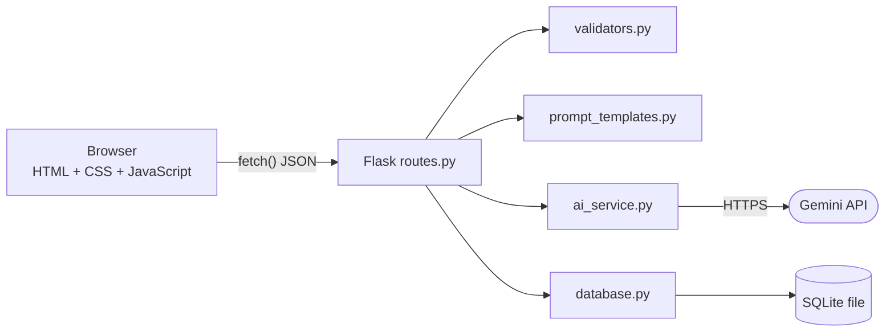
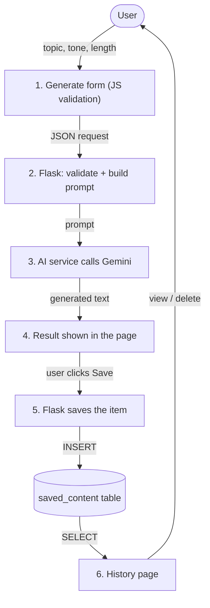
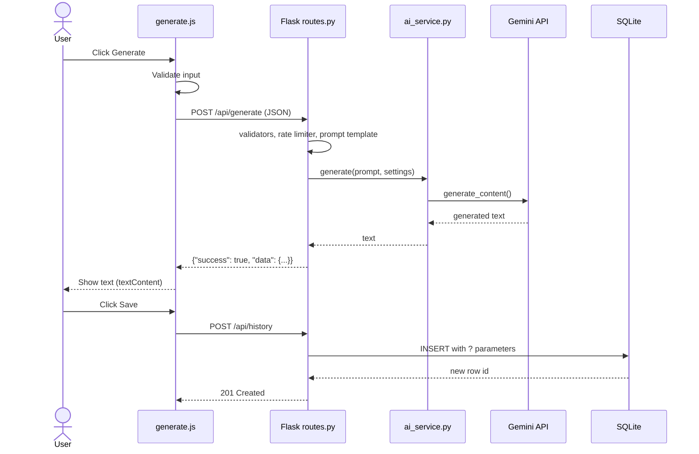

# ContentCraft AI

An AI-powered content generation website built with Flask, vanilla JavaScript, SQLite and the Google Gemini API.

## Abstract
ContentCraft AI is a web application that helps users produce written content with a large language model. A user chooses a task (text generation, summarization, email writing, creative writing, rewriting, grammar improvement or social media captions), a tone and a length, and the system returns generated text without reloading the page. Results can be copied or saved to a local SQLite database and reviewed later in a history page. The project demonstrates a layered web architecture: a browser front end, a Flask REST API, a SQLite persistence layer and a replaceable AI-provider service.

## Problem Statement
Students, teachers and professionals often spend a lot of time drafting, summarizing and polishing text. General-purpose AI chat tools are not organized around these repeated writing tasks and do not keep a simple history. A focused tool is needed that offers task-specific prompts, easy controls for tone and length, and a way to keep useful results.

## Objectives
- Build a complete, responsive web application using a simple, explainable stack.
- Integrate a free-tier AI API securely (API key kept on the server).
- Provide seven writing tasks with separate prompt templates.
- Store and manage saved content in SQLite with safe, parameterized queries.
- Handle invalid input, quota limits, timeouts and network errors gracefully.
- Document the design clearly enough to be explained in a viva.

## Proposed Solution
A Flask server renders the pages and exposes a JSON API. The browser sends the user's choices to `POST /api/generate`. The server validates them, builds a prompt from a template, calls the AI provider through `ai_service.py`, and returns the text. A save endpoint stores items in SQLite, and the history page reads them back.

## Technology Stack
| Layer | Technology | Why |
|---|---|---|
| Frontend | HTML5, CSS3, vanilla JavaScript | No build tools; every line can be explained |
| Backend | Python 3 + Flask | Small, readable, good for REST APIs |
| Database | SQLite (`sqlite3`) | Zero setup, a single file, ideal for single-user apps |
| AI | Google Gemini API (`google-genai` SDK) | Has a free tier for development and an official Python SDK |
| Config | `python-dotenv` + `.env` | Keeps secrets out of source code |

## System Architecture


## Data Flow


### How a request travels


1. **Frontend:** `generate.js` checks the form and sends JSON with `fetch()`.
2. **Flask:** `routes.py` receives it; `validators.py` re-checks it; `prompt_templates.py` builds the prompt.
3. **AI API:** `ai_service.py` sends the prompt to Gemini using the server-side key and returns the text.
4. **Response:** Flask wraps the text in JSON; the browser shows it using `textContent`.
5. **SQLite:** only when the user clicks Save, `database.py` inserts a row. History reads rows back.

## Folder Structure
```text
ContentCraft-AI/
├── app.py                  # creates the Flask app, registers routes and error handlers
├── config.py               # settings read from .env
├── requirements.txt
├── .env.example            # template for your private .env
├── backend/
│   ├── routes.py           # page routes + REST API routes
│   ├── ai_service.py       # Gemini integration (replaceable)
│   ├── prompt_templates.py # prompts and option lists
│   ├── database.py         # all SQL
│   ├── validators.py       # input checks
│   └── rate_limiter.py     # simple request limiter
├── frontend/
│   ├── templates/          # base, index, dashboard, generate, history, about, 404
│   └── static/             # css/style.css, js/*.js, images/logo.svg
└── instance/contentcraft.db   # created automatically
```

## Database Schema
Table `saved_content`:

| Column | Type | Notes |
|---|---|---|
| id | INTEGER | Primary key, auto-increment |
| title | TEXT | Taken from the first line of the input |
| content_type | TEXT | e.g. `email`, `summarization` |
| user_input | TEXT | What the user typed |
| generated_content | TEXT | The AI result |
| tone | TEXT | e.g. `professional` |
| output_length | TEXT | `short`, `medium` or `long` |
| created_at | TEXT | UTC ISO timestamp |

## API Documentation
Successful responses: `{"success": true, "data": ...}`. Errors: `{"success": false, "error": {"code": "...", "message": "..."}}`.

| Method | Route | Purpose | Success | Common errors |
|---|---|---|---|---|
| GET | `/api/health` | Server status; whether a key is configured | 200 | |
| POST | `/api/generate` | Generate content | 200 | 400 invalid input, 429 rate/quota limit, 502/503/504 AI problems |
| POST | `/api/history` | Save an item | 201 | 400 |
| GET | `/api/history?limit=100` | List items (newest first) | 200 | 500 |
| GET | `/api/history/<id>` | One full item | 200 | 404 |
| DELETE | `/api/history/<id>` | Delete an item | 200 | 404 |

Example request to `POST /api/generate`:
```json
{
  "content_type": "email",
  "user_input": "Ask my professor for a two-day extension",
  "tone": "formal",
  "output_length": "short",
  "extra_instructions": "Mention the lab report"
}
```
Valid `content_type` values: `text_generation`, `summarization`, `email`, `creative_writing`, `rewrite`, `grammar`, `social_media`. Valid `tone`: `professional`, `friendly`, `formal`, `creative`, `casual`. Valid `output_length`: `short`, `medium`, `long`.

## Installation and Execution (Windows, VS Code)
1. Install Python 3.10+ and VS Code. Open the project folder in VS Code.
2. In the terminal: `python -m venv venv`
3. Activate: PowerShell `.\venv\Scripts\Activate.ps1`, or Command Prompt `venv\Scripts\activate.bat`
4. `pip install -r requirements.txt`
5. Copy `.env.example` to `.env` and put your Gemini API key in it (from Google AI Studio).
6. `python app.py`, then open http://127.0.0.1:5000
7. Health check: http://127.0.0.1:5000/api/health

## Functional Features
- Seven content tasks with separate prompt templates
- Tone and length selection plus optional extra instructions
- Loading indicator, copy, save, regenerate and clear controls
- History with preview, full view, and deletion after confirmation
- Dashboard with real recent activity from the database
- Light theme by default, optional dark mode
- Friendly errors for missing/invalid key, quota, timeout and network failures

## Testing Checklist
- [ ] `/api/health` returns `"status": "ok"`
- [ ] Empty input shows a validation message
- [ ] Each of the 7 content types returns sensible output
- [ ] Copy, Save, Regenerate and Clear work
- [ ] Saved item appears in History and the Dashboard
- [ ] View opens the full item; Delete asks for confirmation and removes it
- [ ] Removing the API key from `.env` shows a clear error
- [ ] Making more than the rate limit of requests per minute shows the "too many requests" message
- [ ] Layout works at phone, tablet and desktop widths; dark mode toggles

## Security Notes
- API key lives only in `.env` on the server; it is never sent to the browser or stored in the database.
- SQL uses `?` parameters. Output is inserted with `textContent`, not `innerHTML`.
- Input length, request size and request frequency are limited.

## Current Limitations
- Single-user and local: there is no login. Anyone who can open the site sees the saved history. Real multi-user use needs authentication and authorization.
- The rate limiter keeps counts in memory, so it resets on restart and does not work across multiple server processes.
- The free tier of an AI provider may change, has quotas, and may require billing in future.
- AI output can be inaccurate and must be reviewed.
- The Flask development server is not meant for production traffic.

## Future Enhancements
User accounts, streaming responses, editing saved items, search and filters in history, export to PDF/Word, support for more AI providers, automated tests, deployment with Gunicorn/Waitress behind HTTPS.

## Viva Questions and Short Answers
1. **Why does the API key stay on the server?** Anything sent to the browser can be read by users. The server calls the AI and returns only the result.
2. **What is a REST API?** A set of URLs and HTTP methods (GET, POST, DELETE) that exchange data, usually JSON.
3. **What is SQL injection and how is it prevented here?** Attackers put SQL into input. We pass values through `?` placeholders, so they are treated as data, never as SQL.
4. **Why `textContent` instead of `innerHTML`?** `innerHTML` would run HTML/JavaScript inside generated or saved text (XSS). `textContent` shows it as plain text.
5. **What is a Flask Blueprint?** A way to group routes; here one for pages and one for the `/api` routes.
6. **What does `.env` do?** It stores settings and secrets outside the code; `python-dotenv` loads them into the environment.
7. **What happens on HTTP 429?** The AI quota or our rate limit was hit; the user gets a clear message to wait.
8. **Why SQLite?** No server to install, one file, enough for a single-user project.
9. **How would you add another AI provider?** Write a new class with a `generate()` method in `ai_service.py` and return it from `get_ai_service()`.
10. **Why validate in both JavaScript and Python?** JavaScript gives instant feedback; Python is the real protection because requests can bypass the browser.
11. **Why is CORS not needed?** The pages and API are served from the same origin (same host and port).
12. **What are the prompt templates?** Text with placeholders for tone, length and user input, one per task, in `prompt_templates.py`.
13. **How would you add authentication?** Add a users table, password hashing, sessions (e.g. Flask-Login), and a `user_id` column on `saved_content`.
14. **What are the limitations?** See "Current Limitations".

## Why These Technologies?
- **Python:** readable, with excellent libraries and an official AI SDK.
- **Flask:** minimal and easy to explain compared with larger frameworks.
- **JavaScript:** the only language browsers run natively, needed for interactions without page reloads.
- **SQLite:** simple, built into Python, no administration.
- **Gemini API:** free tier for learning and an official Python SDK (limits may change).